<div align="center">

# 📺 RustPlay

### Your screen, anywhere.

**A free, open-source AirPlay app for Windows — receive your iPhone on your PC, or send your PC to a TV.**

🆓 Free · 🔓 Open source · 🚫 No ads · ⚡ GPU accelerated · 🦀 Written in Rust

</div>

> [!NOTE]
> 🤖 **This app was vibe-coded.** RustPlay was built almost entirely by describing what I wanted to an AI coding assistant and iterating on the result, rather than writing every line by hand. It works well for me, but expect rough edges, and please review the code before trusting it with anything sensitive. Bug reports and pull requests are very welcome!

---

## 📖 Table of contents

1. [👋 What is RustPlay?](#-what-is-rustplay)
2. [🚀 Getting started in 2 minutes](#-getting-started-in-2-minutes)
3. [✨ Features](#-features)
4. [🛠️ Something not working?](#️-something-not-working)
5. [❓ FAQ](#-faq)
6. [🔬 Technical details](#-technical-details)
7. [🏗️ Building from source](#️-building-from-source)
8. [📜 License](#-license)

---

# Part 1 — The simple version 😊

## 👋 What is RustPlay?

RustPlay lets your Windows PC talk to Apple devices **without installing anything on the phone**.

| 📱➡️💻 **Receive** | 💻➡️📺 **Send** |
|---|---|
| Show your **iPhone, iPad or Mac** screen on your PC. Play its music through your PC speakers. Watch videos from apps like YouTube on your PC. | Show your **PC screen** on an **Apple TV, a smart TV or a HomePod-style speaker** that supports AirPlay. |

It feels just like AirPlay on a Mac — but on Windows, and free.

## 🚀 Getting started in 2 minutes

The first time you open RustPlay, a short animated tour walks you through everything:

<p align="center">
  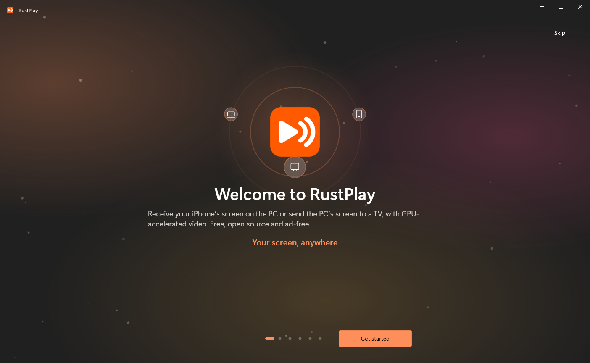
  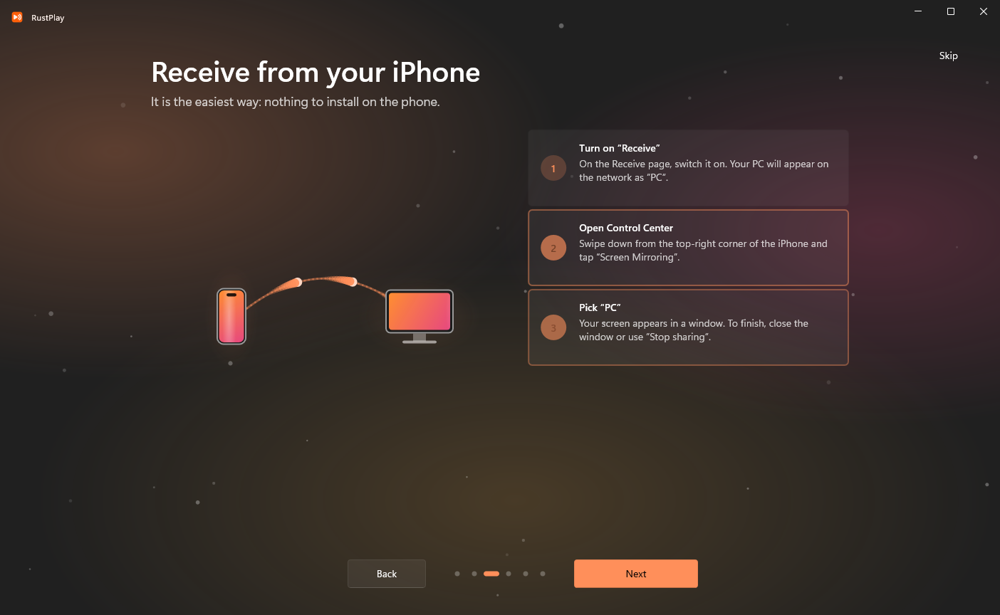
  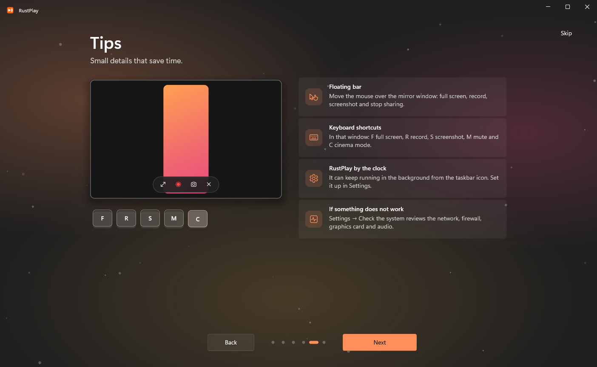
</p>

> 💡 You can replay the tour any time from **Settings → Introduction to RustPlay**.

### 📱➡️💻 Show your iPhone on your PC

1. Open RustPlay and go to the **Receive** page.
2. Turn the switch **on**. Your PC now appears on the network with the name you chose (default: *PC*).
3. On your iPhone, swipe down from the top-right corner to open **Control Center** and tap **Screen Mirroring**.
4. Pick your PC from the list. If the iPhone asks for a code, type the 4-digit code RustPlay shows on your PC. 🔢
5. Your iPhone appears in a window on your PC. To stop, close the window or press **Stop sharing**.

### 💻➡️📺 Show your PC on a TV

1. Go to the **Send** page. RustPlay looks for devices on its own.
2. Click **Duplicate** next to your TV or Apple TV.
3. The first time, type the PIN shown on the TV. 🔐 RustPlay remembers it afterwards.
4. Your PC screen appears on the TV. Done! 🎉

> ⚠️ Your PC and your devices must be on the **same Wi-Fi / network**.

---

## ✨ Features

### 📺 Send your screen to a TV

Find every AirPlay device on your network in one list, see which are online, and start sharing with one click.

<p align="center">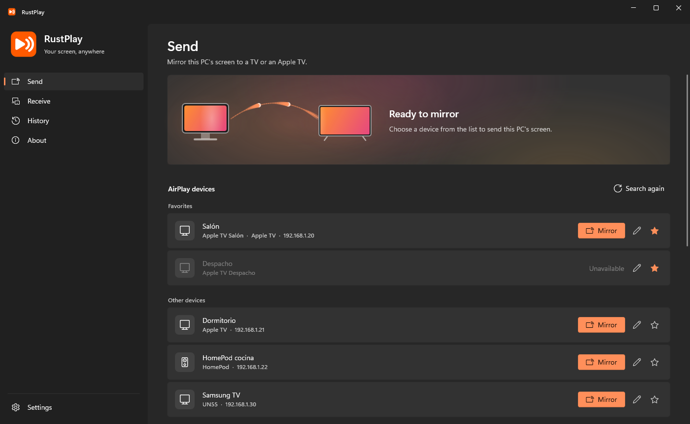</p>

- 🔍 **Automatic discovery** of Apple TVs, smart TVs and speakers
- ⭐ **Favorites** — pin the devices you use most; they stay at the top, even when offline
- ✏️ **Rename devices** so "UN55" becomes "Living-room TV"
- 🖥️ Share the **whole screen** or **just one window**
- 🔊 Sends the **sound of your PC** too
- 🔑 Pair once with a PIN, never again

<p align="center">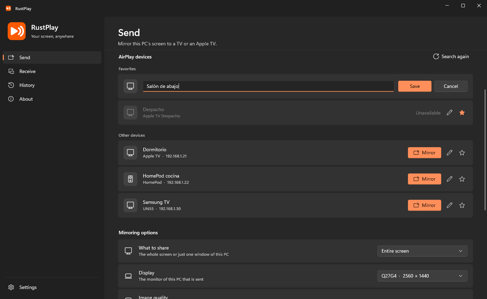</p>

### 📱 Receive from iPhone, iPad and Mac

Turn your PC into an AirPlay receiver. Pick a name, flip a switch, and it shows up in Control Center.

<p align="center">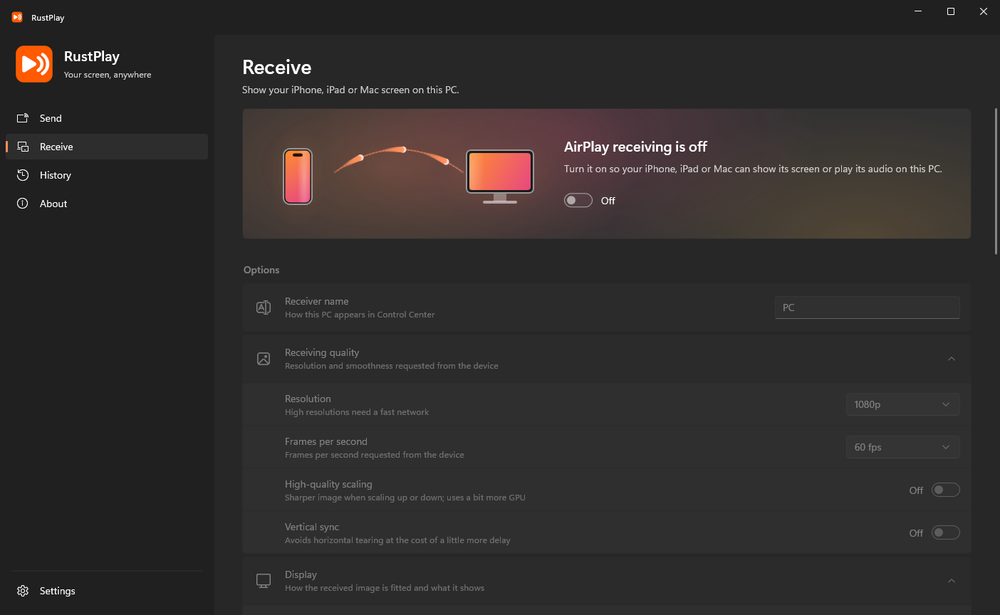</p>

- 🖼️ **Screen mirroring** with sound, rotation and low delay
- 🎵 **Audio streaming** — use your PC as a speaker for iPhone music and podcasts
- 🎬 **Videos from apps** (YouTube and others) play full quality in a built-in player with play/pause, seek, speed, subtitles and volume controls
- 📸 **Photos** sent from the iPhone are shown on your PC
- 👥 **Several devices at once** (optional) — each one gets its own window
- 🔁 **Reconnects gracefully** — if the phone goes to sleep, the window waits for it to come back
- 🔒 Optional **4-digit code** so only devices you trust can connect (each paired device is remembered)

### 🪟 A mirroring window with superpowers

Move the mouse over the window and a **floating bar** appears. Or use the keyboard:

| Key | What it does |
|:---:|---|
| **F** / **F11** | ⛶ Full screen |
| **R** | 🔴 Record |
| **S** | 📷 Screenshot |
| **M** | 🔇 Mute |
| **C** | 🪟 Borderless window |
| **L** | 🔒 Lock window position |
| **T** | 📌 Always on top |
| **I** | 📊 Show statistics |
| **B** | 🌙 Keep playing in the background |

<p align="center">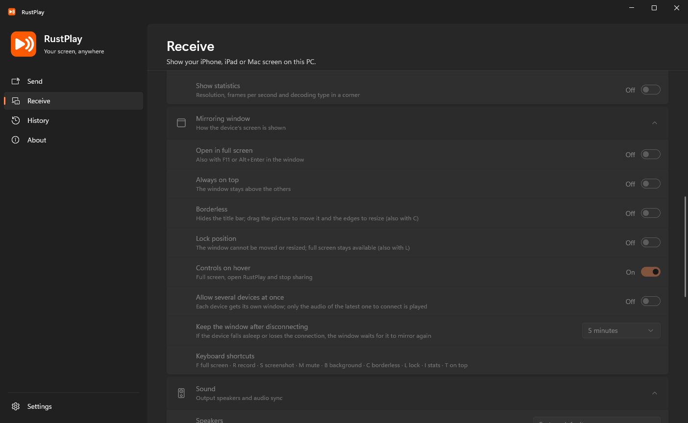</p>

- 🎞️ **Cinema mode** — borderless, black background, just the picture
- 🔴 **Recording** — records what you see, and starts exactly when you press the button (even a few seconds *before*, thanks to a rolling buffer)
- 📷 **Screenshots** saved to your folder in one keypress

### 🕘 History

Every connection, recording, screenshot and error is logged, grouped by day, with buttons to open the file or its folder.

<p align="center">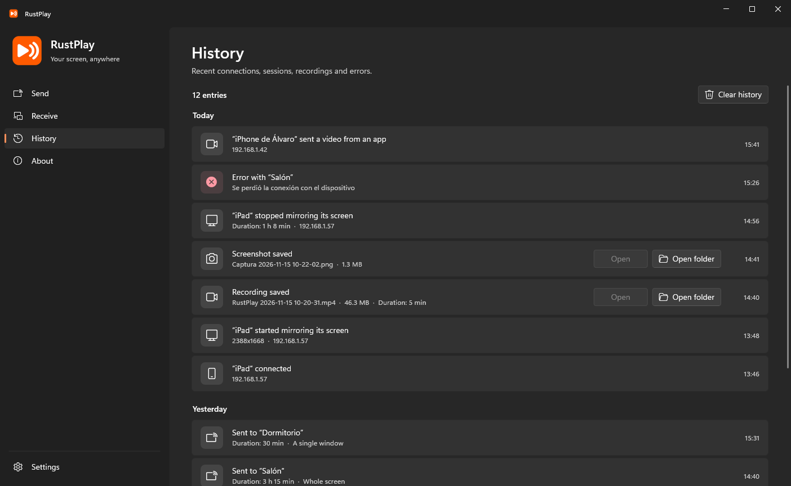</p>

### ⚙️ Settings that make sense

<p align="center">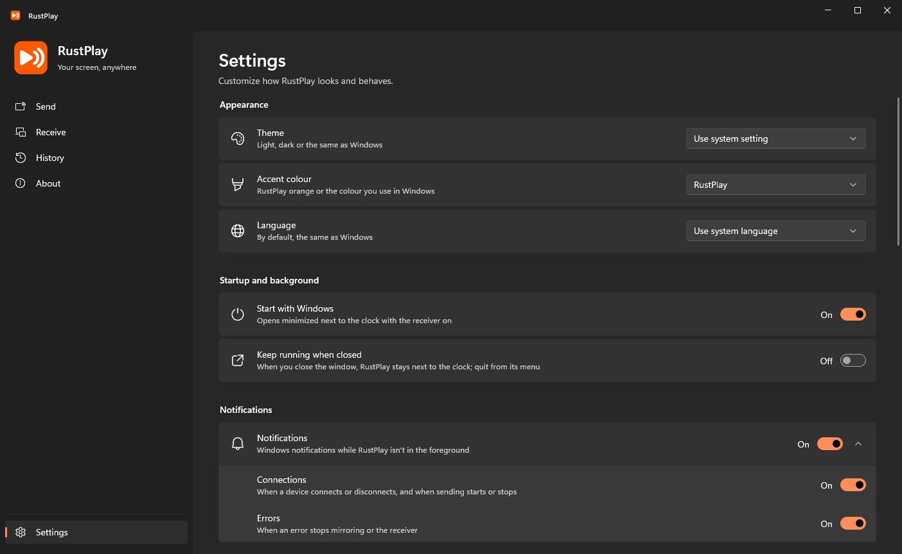</p>

- 🎨 **Light, dark or system theme**, plus your Windows accent colour or RustPlay orange
- 🌍 **Spanish and English**
- 🚀 **Start with Windows** — quietly, minimized next to the clock, with the receiver already on
- 🔔 **Windows notifications** when devices connect or something fails
- 🧭 **System tray icon** with quick actions and your favourite devices
- ⬆️ **Automatic updates** (checked, verified and installed from inside the app)
- 💼 **Portable version** — runs from a USB drive, no installation

<p align="center">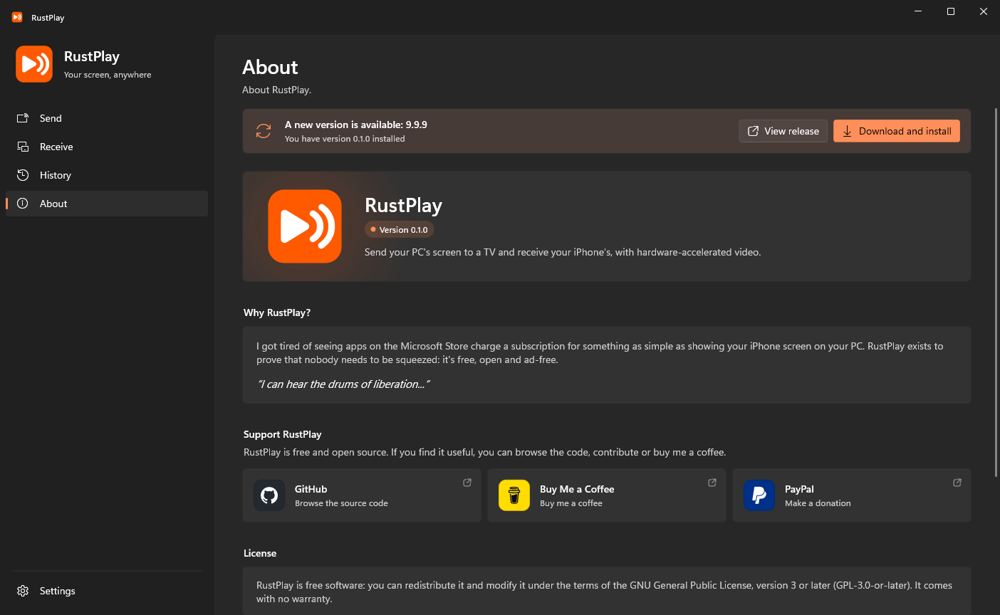</p>

### 🩺 Built-in system check

If something doesn't connect, RustPlay can diagnose your PC for you and fix the usual suspects with one click.

<p align="center">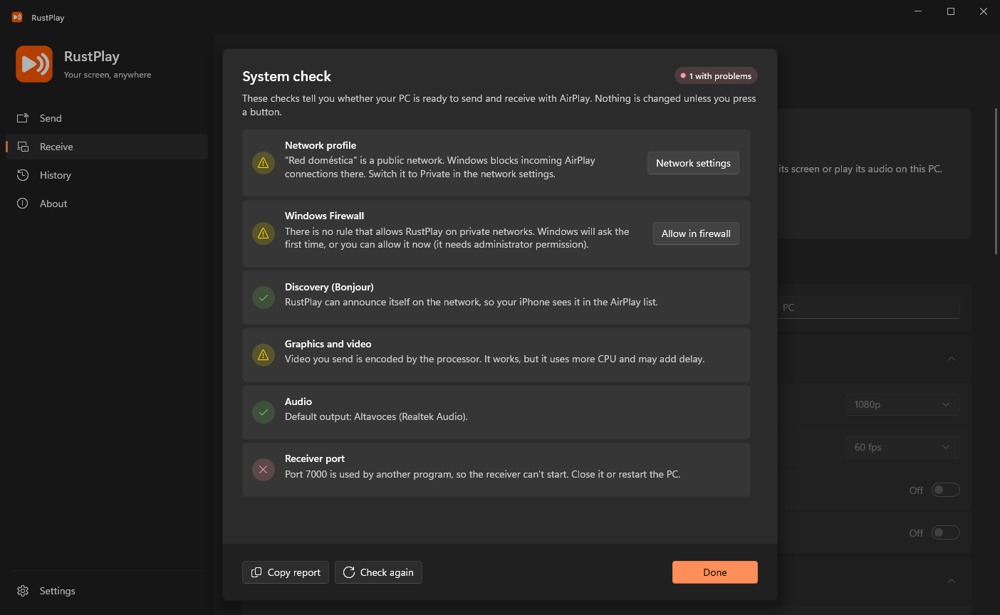</p>

It checks your **network profile**, **Windows Firewall**, **discovery (Bonjour)**, **graphics card**, **audio output** and **port availability** — and tells you in plain words what to do. Nothing is changed unless you press a button.

---

## 🛠️ Something not working?

| Problem | Try this |
|---|---|
| 😕 My PC doesn't show up on the iPhone | Make sure **Receive** is on and both are on the **same network**. Run **Settings → System check**. |
| 🔥 Windows asked about the firewall | Allow RustPlay on **private networks**. |
| 🌐 "Public network" warning | In Windows network settings, switch your Wi-Fi to **Private**. |
| 🔢 PIN doesn't appear | Check you're pairing with the right device; the code appears on the TV (sending) or on your PC (receiving). |
| 🐢 Video is choppy | Lower the resolution or FPS in **Receive → Reception quality**, or use 5 GHz Wi-Fi / Ethernet. |
| 🔇 No sound | Check your default output device in Windows and the mute (**M**) key. |

---

## ❓ FAQ

**Do I need to install anything on my iPhone?** No. It uses the AirPlay that's already built into iOS and macOS.

**Does it work with Android?** No — AirPlay is an Apple protocol.

**Is it really free? Any ads or tracking?** Free, open source, and no ads.

**Which devices can I send to?** Apple TV, AirPlay-capable smart TVs, and speakers that accept AirPlay.

**Which iPhones are supported?** iOS 17 and newer (and tvOS 17+ for Apple TV).

---

<br>

# Part 2 — The technical version 🤓

## 🔬 Technical details

### 🧱 Architecture

RustPlay is a Cargo workspace of five crates:

| Crate | Role |
|---|---|
| `crates/core` | Shared protocol and Windows media code: mDNS, RTSP/HTTP codec, HAP/FairPlay crypto, RTP + jitter buffer, NTP clock, identity & pairing store, GPU device, video decoder/encoder/presenter, audio renderer/loopback, recorder, screenshots, the native HLS player and photo viewer. |
| `crates/rx` | **Receiver**: RTSP/HTTP session server, pairing, mirroring and audio streams, AirPlay video hub (reverse channel), photo handler. |
| `crates/tx` | **Sender**: device discovery, pairing client, mirroring and audio streams. |
| `crates/cli` | Command-line binary for headless use (`list`, `recv`, `send`). |
| `crates/gui` | The desktop app: custom Direct2D/DirectComposition UI, tray, notifications, history, updater, system check, welcome tour. |

### 📡 Protocol

- **Discovery** — native Windows DNS-SD (`DnsServiceRegister` / `Browse` / `Resolve`), publishing `_airplay._tcp` and `<MAC>@name._raop._tcp` with the proper TXT records.
- **Pairing** — legacy pair-setup / pair-verify and **HAP** (SRP-6a with PIN, Ed25519, X25519, HKDF, ChaCha20-Poly1305 framed control channel).
- **FairPlay** — `playfair` SAP handshake ported to Rust (receiver side), plus the sender-side client for tvOS 17+.
- **Streams** — RTSP control, encrypted H.264 mirroring (AES-CTR / `DataStream-Salt` keys), RTP audio (ALAC and AAC), NTP-style timing, retransmission and a pre-allocated jitter buffer.
- **Video playback from apps** — the receiver implements the AirPlay video hub: `play`, `rate`, `scrub`, `playback-info`, volume, and `EVENT/1.0` acknowledgements over the reverse channel.

### 🎬 Native HLS player (no VLC, no external binaries)

Videos sent from apps like YouTube are played by a **player written from scratch**:

- WinHTTP client with live and VOD playlists, **adaptive bitrate (ABR)** selection
- **MPEG-TS** and **fMP4** demuxing, packed ADTS audio
- H.264 hardware decode (Media Foundation + DXVA) → D3D11 **VideoProcessor** blit; AAC via Media Foundation
- **Audio-driven master clock**, WSOLA pitch-preserving playback speed, WebVTT subtitles

### ⚡ Performance

- Decode and encode stay on the **GPU** (D3D11 surfaces, NV12); frames never return to the CPU on the hot path.
- Hardware H.264 encoder (MFT) with `LowLatencyMode`; software fallback with a warning.
- Flip-model swap chain presentation; audio through **WASAPI** shared mode, event driven, using `IAudioClient3` low-latency periods.
- No per-frame / per-packet heap allocation: pre-allocated buffers, texture pools and reusable `BytesMut`.
- Recording uses a **GOP cache** for instant preroll; when the cache is too long it falls back to a GPU re-encode.

### 🖥️ Interface

A custom **Direct2D + DirectComposition** renderer (no WinUI/Electron/WebView): Mica-style backdrop, per-element animation, light/dark/high-contrast themes, keyboard navigation, full localisation through `crates/gui/lang/{es,en}.json`.

### 🔒 Privacy & dependencies

- **No telemetry.** The only network traffic is AirPlay on your LAN and, if enabled, the update check.
- Pure-Rust crypto (`ed25519-dalek`, `x25519-dalek`, `chacha20poly1305`, `aes`, `sha2`, `hkdf`, `srp`…); Windows APIs through the `windows` crate. **No FFmpeg, GStreamer or VLC at runtime.**
- Updates are verified against a SHA-256 checksum before being installed.

### 💻 CLI

```powershell
rustplay-cli list                     # discover AirPlay devices
rustplay-cli recv --name "PC"         # run as a receiver
rustplay-cli send "Living room TV"    # mirror this PC to a device
```

## 🏗️ Building from source

Requirements: Windows 10/11 x64, the stable **Rust** toolchain (`x86_64-pc-windows-msvc`) and the Visual Studio C++ build tools with the Windows SDK.

```powershell
git clone https://github.com/alvarilloo/rustplay.git
cd rustplay
cargo build --release -p rustplay -p rustplay-cli
.\target\release\RustPlay.exe
```

Run the tests and lints:

```powershell
cargo test --workspace
cargo clippy --workspace --all-targets -- -D warnings
```

Packaging scripts live in [`packaging/`](packaging): `build-installer.ps1` (Inno Setup), `build-msix.ps1` and `build-portable.ps1`.

## 📜 License

RustPlay is licensed under **GPL-3.0-or-later** — see [LICENSE](LICENSE). It derives from or ports knowledge from UxPlay, playfair, MultiDrop, doubletake and FFmpeg; see [NOTICE](NOTICE) for the full attributions.

---

<div align="center">

Made with 🦀 and ❤️ — enjoy your screen, anywhere.

</div>
